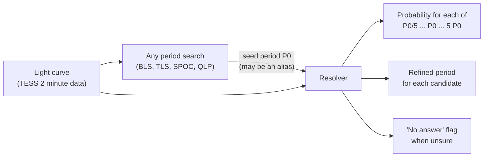
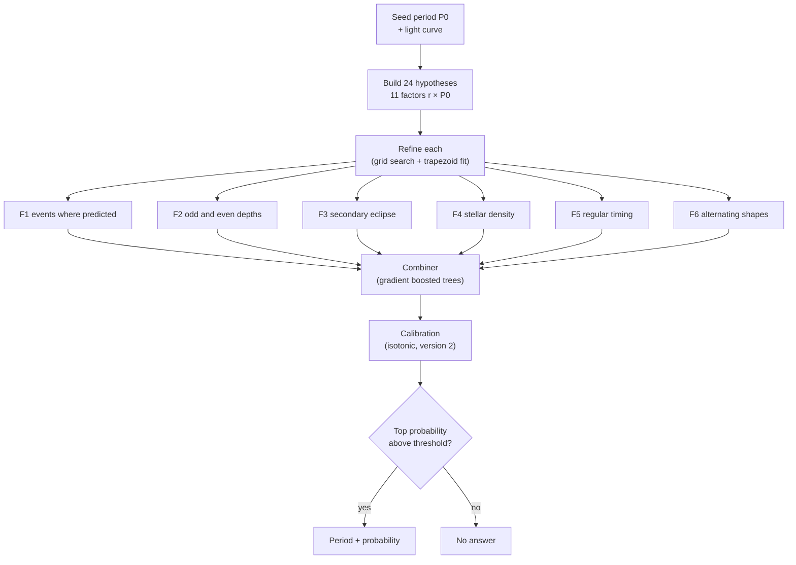
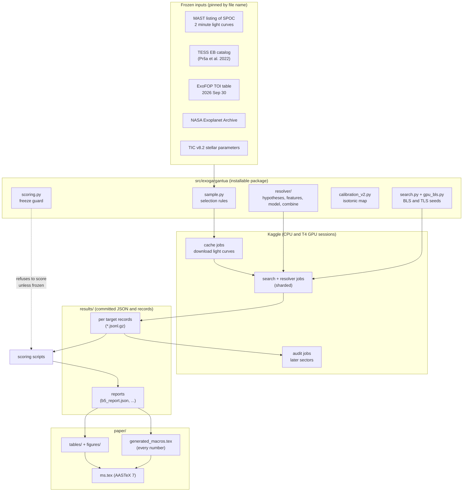
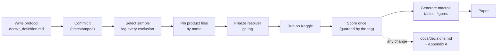
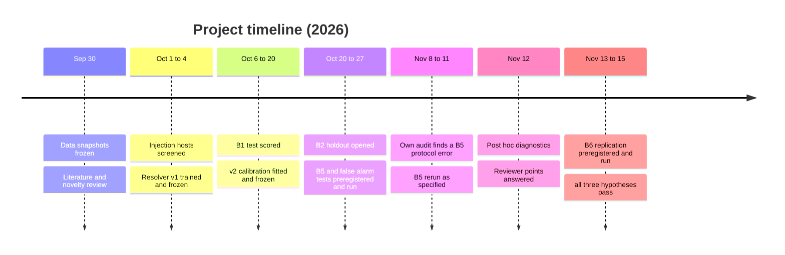
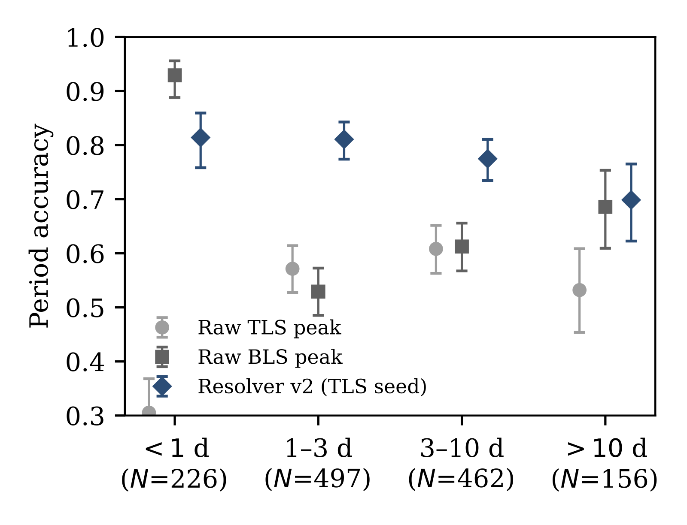
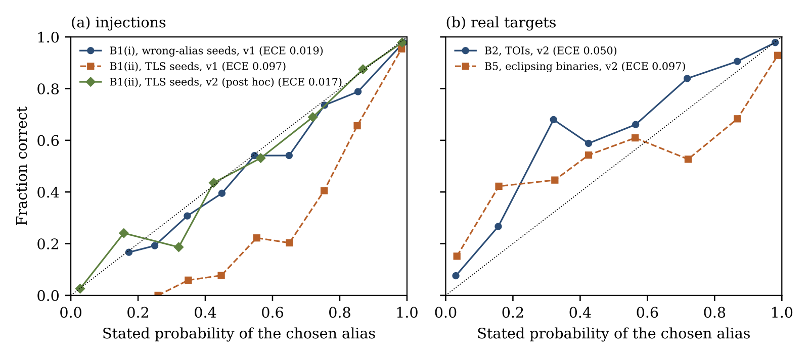
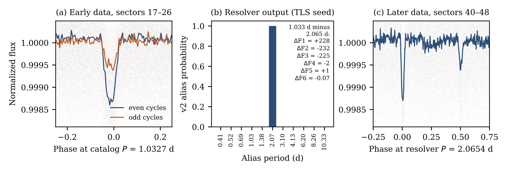
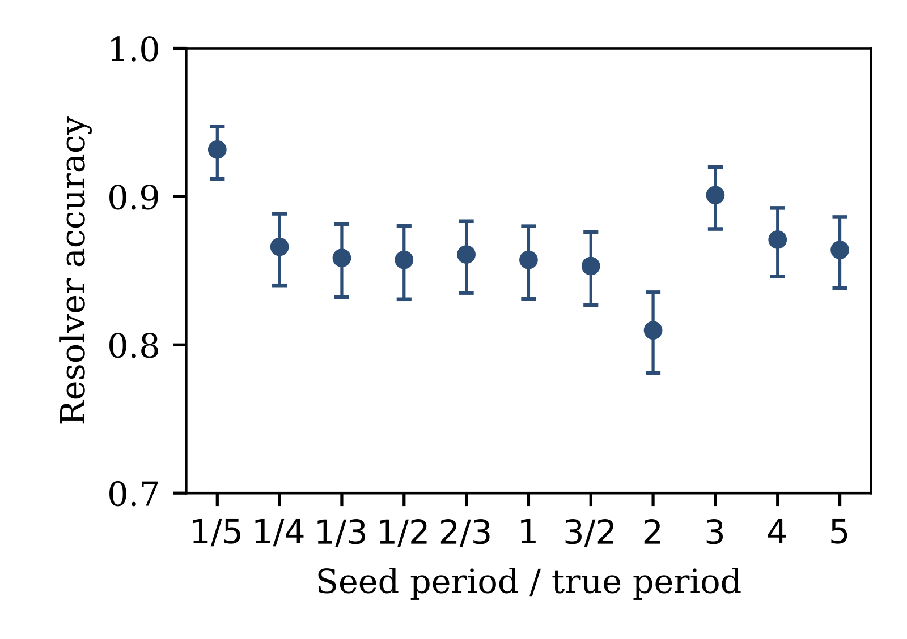
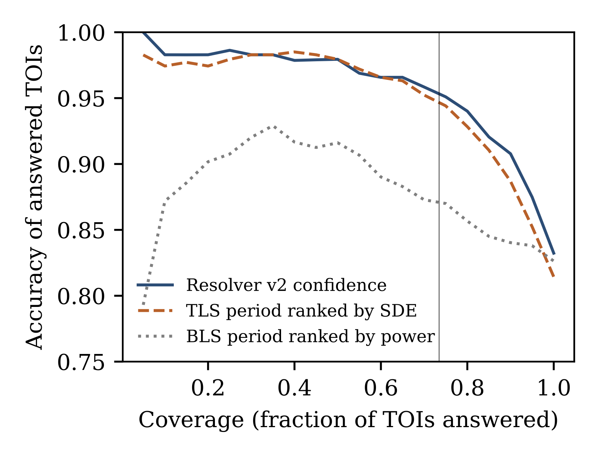

<!-- This file is the template of README.md. Edit it here, then run `python scripts/make_readme.py`.
     Every number is filled in from paper/generated_macros.tex, the same values the paper uses. -->

# Exo-Gargantua

**Finding the right orbital period in TESS light curves.**
A resolver that checks whether a detected period is really a multiple or a fraction of the true one,
gives a probability for each candidate period, and was tested on six benchmarks that were written down
before their data were analyzed.

[](LICENSE)


[](https://doi.org/10.5281/zenodo.24490731)

| | |
|---|---|
| **Author** | Srijeet Prasad Banerjee ([ORCID 0009-0009-5889-9550](https://orcid.org/0009-0009-5889-9550)), Guru Nanak Institute of Technology, Kolkata |
| **Paper** | *Resolving Period Aliases in TESS Light Curves: Preregistered Tests on Eclipsing Binaries, Injected Signals, and TESS Objects of Interest* (in preparation for The Astronomical Journal). Source: [`paper/ms.tex`](paper/ms.tex) |
| **Data** | 44,014 SPOC 2 minute light curves of 25,811 stars, TESS Sectors 1 to 106 ([doi:10.17909/t9-nmc8-f686](https://doi.org/10.17909/t9-nmc8-f686)) |
| **Branches** | `main` (current), `v2-alias-resolver` (development). The rejected first version is kept read only in [`legacy/`](legacy/) |

---

## Contents

1. [The problem](#1-the-problem)
2. [Results at a glance](#2-results-at-a-glance)
3. [What we found](#3-what-we-found)
4. [How the resolver works](#4-how-the-resolver-works)
5. [System architecture](#5-system-architecture)
6. [Research workflow](#6-research-workflow)
7. [The benchmarks](#7-the-benchmarks)
8. [How we kept the results honest](#8-how-we-kept-the-results-honest)
9. [Figures](#9-figures)
10. [Released data products](#10-released-data-products)
11. [Limitations](#11-limitations)
12. [Reproducing everything](#12-reproducing-everything)
13. [Repository map](#13-repository-map)
14. [Citation, license and acknowledgments](#14-citation-license-and-acknowledgments)

---

## 1. The problem

TESS finds transiting planets and eclipsing binaries by searching light curves for repeating dips. Every
detection comes with a period: the trial period at which the search found the strongest signal. That period
is not always the true one. Often it is a simple multiple or fraction of it, which we call an **alias**:

* **Eclipsing binaries with similar eclipses.** The primary and secondary eclipses look alike, so the search
  folds them together and reports **half** the orbital period.
* **Gaps in the data.** TESS observes in 27 day sectors with a gap in the middle. A transit that falls in a gap
  makes the search report **twice** (or three times) the true period, or makes half the period impossible to rule out.

A wrong period sends telescopes to look for transits that never happen, puts a binary in the wrong place in
population studies, and gives machine learning classifiers wrong labels. Existing tools flag aliases with fixed
rules or human inspection. None of them gives a **tested probability** for each possible period.

**The question this project answers:** given a signal that is already accepted as real, and the period a
search found for it, which of the related periods is the true one, and how sure can we be?



---

## 2. Results at a glance

Main numbers, all from the committed results files. "Accuracy" is the fraction of targets whose period
is within 0.1% of the truth; twice or half the period counts as wrong.

| Benchmark | Sample | Resolver | Raw TLS | Raw BLS | Goal written in advance | Outcome |
|---|---|---|---|---|---|---|
| **B5** eclipsing binaries | 1,341 binaries | **78.6%** | 53.5% | 64.4% | beat TLS and BLS, p < 0.01 | **met** (p = 1 × 10⁻⁵⁵ and p = 5 × 10⁻²⁴) |
| **B6** replication on new binaries | 1,597 binaries | **78.0%** | 54.5% | 62.6% | three tests, each p < 0.0033 | **all three met** |
| B6, inside the TLS search range | 935 binaries | **77.3%** | 66.2% | | beat TLS | **met** (p = 2 × 10⁻⁹) |
| **B1** injected signals, wrong starting period | 8,620 injections | **86.6%** | | | calibration error below 0.05 | **met** (ECE 0.019) |
| B1 injected signals, search starting period | 2,000 injections | 79.1% | 60.8% | 64.4% | calibration error below 0.05 | missed (ECE 0.097); fixed post hoc (0.017) |
| **B2** TESS Objects of Interest | 1,169 TOIs | 83.2% | 81.4% | 82.6% | beat TLS, BLS and SPOC | **missed** (comparable) |
| **False alarms** (scrambled light curves) | 1,198 | confident on 37.2% | | | below 5% | **missed** |
| **B4** run time, full Sector 49 | 19,997 light curves | median 4.56 s each | | | measure | done |

Pooled over B5 and B6 (2,938 binaries): resolver **78.3%**, TLS 54.0%, BLS 63.4%.

---

## 3. What we found

Each finding below is in the paper with its exact numbers, intervals and tests. "Post hoc" marks an
analysis that was designed after the main results were known; those are descriptions, not tests.

### 3.1 The resolver recovers the true period of eclipsing binaries far more often than the searches do
On 1,341 TESS eclipsing binaries with one year of data, the resolver started from the TLS period returns the
catalog period for **78.6%**, against 53.5% for TLS and 64.4% for BLS. Against TLS it fixes
418 periods and breaks 81; against BLS it fixes 281 and breaks 90.

### 3.2 The result replicates on fresh data
We wrote a replication protocol (B6) before downloading any more data and ran it on the 1,782
binaries that B5 left out at random. All three preregistered hypotheses passed: **78.0%** against
54.5% for TLS and 62.6% for BLS; **77.3%** against 66.2% for TLS inside its own
search range; and **78.5%** against 62.6% when started from BLS.

### 3.3 Raw period searches return an alias for about a third of binaries (post hoc)
The TLS period is at an alias of the catalog period for **35.2%** of binaries, and the BLS period for
**28.0%**, mostly at half the period for BLS (26.5%). Most errors of the searches are aliases
(75.6% of wrong TLS periods, 78.5% of wrong BLS periods). After the resolver, 14.1% remain at an alias.

### 3.4 TLS cannot reach the period of many short period binaries when given real stellar radii (post hoc)
TLS builds its period grid for a single star and starts it at an orbit three stellar radii wide. Binaries often
have large catalog radii, so for **265 of 1,019** binaries with a TIC radius and mass the true period lies
below the grid and TLS cannot return it (0.0% correct, against 71.3% with default values).
The resolver still recovers **84.9%** of them because it also tries P0/2, P0/3 and smaller. This is a
practical warning for anyone running TLS on binaries.

### 3.5 Released TOI periods are rarely aliases (post hoc)
Comparing the TOI catalog of the first two TESS years with today's ExoFOP table, only **55 of 2,172
TOIs (2.5%)** later had their period changed by an alias factor, and they are no more often false positives
than other TOIs (38.2% against 34.5%). Human vetting already catches most aliases in the released
catalog; the value of an automatic check is in raw search output and in single sector detections.

### 3.6 Later TESS data side with the catalog and the resolver about equally often
Where the resolver disagrees with the binary catalog, we fitted the later sectors (which neither had seen) at
both periods. In B5, later data favor the resolver for **78** binaries and the catalog for **79**
(187 undecided); in B6, **112** and **101** (206 undecided). The decided cases are released
as candidate period revisions.

### 3.7 A cataloged "binary" that is probably a planet transit on the neighboring star
TIC 92352621 (WASP-94 B) is listed in the binary catalog with a period of about twice the resolver's
value. The resolver's period, 3.9501 d, matches the known planet WASP-94 A b (3.95019 d) on the
neighboring star, so the signal is most likely that planet's transit diluted in the shared aperture.

### 3.8 Which physics decides the answer (post hoc)
Leaving each of the six tests out in turn shows that "events where they are predicted" (F1) carries most of the
information, and that odd and even depths (F2) and the secondary eclipse (F3) matter most for binaries. The
stellar density test (F4) **lowers** accuracy on binaries, because it assumes a single star; on B5 and B6 the
simple sum of the tests is as accurate as the learned combiner.

### 3.9 Probabilities: reliable on simulations, too confident on real binaries
On injected signals started from a wrong period the calibration error is **0.019** (goal: below 0.05). On real
binaries it is **0.097** (B5) and **0.105** (B6): of the 841 binaries given more than 90% probability, a
fraction 0.93 are right. On binaries the probabilities should be read as a ranking.

### 3.10 On TOIs it is comparable to the searches; on single sector TOIs it may help (exploratory)
On 1,169 TOIs the resolver (83.2%) is comparable to TLS (81.4%) and BLS (82.6%) and misses its goal.
For TOIs with only one early sector it reaches 82.5% against 77.1% for TLS (p = 0.005 after correcting
for 5 groups). This is a hypothesis for a future preregistered test, not a claim.

### 3.11 It is not a false alarm filter
On scrambled light curves it is confident for 37.2% of targets. Dedicated vetting tools do far better
(LEO-Vetter rejects 99.91% of simulated false alarms), so the resolver must run **after** vetting.

### 3.12 It is fast
A full TESS sector (19,997 light curves) runs at a median of **4.56 s** per light curve, of which the resolver
takes 3.12 s.

---

## 4. How the resolver works

**Step 1: candidate periods.** From the seed period P0 it builds the periods r × P0 for eleven factors
r ∈ {1/5, 1/4, 1/3, 1/2, 2/3, 1, 3/2, 2, 3, 4, 5}. For factors above one it also tries every choice of which seed
events to keep (for 2 × P0: the odd events or the even events), giving 24 hypotheses. Each is refined with a small
grid search and a trapezoid fit, because a true period is rarely an exact multiple of a noisy seed.

**Step 2: six physical tests**, each a log likelihood ratio:

| Test | What it checks | Catches |
|---|---|---|
| **F1** events where predicted | Is there a dip at every time the hypothesis predicts one? | periods that are too short (dips predicted on flat data) or too long (real dips left unexplained) |
| **F2** odd and even depths | Do odd and even events have the same depth? | half period binaries with unequal eclipses |
| **F3** secondary eclipse | Is there a second, separate dip at another phase? | equal depth binaries (at 2 × P0 the other eclipse becomes a secondary) |
| **F4** stellar density | Do duration and ingress match a transit across the TIC star? | wrong periods for planets (but misleads on binaries) |
| **F5** regular timing | Do the events line up across data gaps? | periods that drift out of phase |
| **F6** shape of alternating events | Do odd and even events have the same shape? | binaries whose eclipses differ in shape but not depth |

**Step 3: combine.** A simple combiner adds the tests. A learned combiner (gradient boosted trees) reads the tests and
the quantities behind them; it never sees the factor r, so it cannot learn how seeds were chosen in training. It was
trained only on simulated signals.

**Step 4: calibrate and decide.** Scores become probabilities (temperature scaling, then isotonic regression in
version 2). If the top probability is below a threshold (0.71), the resolver says "no answer".



---

## 5. System architecture



The local machine only writes code, runs unit tests and turns results files into the paper. All heavy work
(downloads, searches, resolver runs, audits) runs as Kaggle jobs defined in [`kaggle/jobs/`](kaggle/jobs/), each pinned to
a code snapshot whose commit is recorded in every output file.

---

## 6. Research workflow



The order of the main steps, as recorded in git:



---

## 7. The benchmarks

| ID | What | Truth | Size | Designed |
|---|---|---|---|---|
| **B1** | Signals injected into quiet stars (60% planets, 40% binaries) | the injected period | 21,550 injections, 8,620 in the test split | before any data |
| **B2** | TOIs, given only their first year of data | NASA Exoplanet Archive or EB catalog | 1,169 TOIs | before the holdout was opened |
| **B3** | Audit of the TOI catalog | | | dropped (it would mostly flag correct periods) |
| **B4** | Run time on all of Sector 49 | | 19,997 light curves | before data |
| **B5** | TESS eclipsing binaries, first year of data | Prša et al. (2022) catalog period | 1,341 binaries | after B1 and B2, before its own data |
| **B6** | Replication of B5 on the binaries B5 left out | same catalog | 1,597 binaries | after B5, before its own data |
| **FA** | Inverted and scrambled light curves | no real signal | 1,198 of each | before data |

Baselines on the same targets: raw BLS, raw TLS, the rule based correction of Tschudi et al. (2026), the SPOC TCE
periods (single sector and multi sector), and the published QLP and SPOC catalog periods.

---

## 8. How we kept the results honest

* **Preregistration.** Every benchmark's sample, truth, baselines, goal and analysis were committed before its data
  were analyzed ([`docs/success_criteria.md`](docs/success_criteria.md), [`docs/b5_definition.md`](docs/b5_definition.md), [`docs/b6_definition.md`](docs/b6_definition.md)).
* **Frozen resolver.** The scoring code refuses to run unless the git tags `resolver-frozen-v1` / `resolver-frozen-v2`
  exist and the resolver files are byte identical to them.
* **No typed numbers.** Every number in the paper is a macro written by [`scripts/make_paper_assets.py`](scripts/make_paper_assets.py) from
  committed results files. This README is filled the same way.
* **Every change logged.** [`docs/decisions.md`](docs/decisions.md) records each decision with its date and reason; the paper's
  Appendix A lists every scientific change.
* **We report what failed.** B2 and the false alarm test missed their goals and are reported as such.
* **We found and fixed our own error.** An internal audit showed the first B5 run had used default stellar
  parameters against the protocol. It was rerun as specified, with the rerun declared the main result before it
  existed; the first run is kept as a sensitivity check.
* **Independent checks.** Reruns of 60 binaries and 60 TOIs reproduce every stored result exactly; a separate
  script recomputes every statistic from the per target records; B5 periods were also checked against Gaia DR3
  and Kostov et al. (2025).
* **Verified citations.** Every reference is built from a DOI or arXiv ID and checked automatically.
* **Planet hosts flagged.** Every released star is cross matched with ExoFOP and the NASA Exoplanet Archive.

---

## 9. Figures

**Recovery of binary periods by period range (B5).** Raw TLS is low at short periods because of its period grid limit.



**Reliability of the probabilities.** Left: injections. Right: real TOIs and binaries (too confident on binaries).



**An audit case (TIC 219882262).** The catalog period folds odd and even eclipses of different depth; later data
confirm the resolver's period of twice the catalog value.



**Accuracy by seed factor on injections (B1)** and **answering only when confident on TOIs (B2).**

| | |
|---|---|
|  |  |

---

## 10. Released data products

All in [`paper/data/`](paper/data/):

| File | Contents |
|---|---|
| `eb_candidate_period_revisions.csv` | binaries of B5 and B6 where later data gave a verdict between the catalog and the resolver period, with TOI and Exoplanet Archive flags. Candidates, not confirmed periods |
| `b5_per_target.csv`, `b6_per_target.csv` | every binary: periods from each method, probability, correctness |
| `b2_per_target.csv` | every TOI: sectors used, S/N, periods from each method |
| `mast/` | the exact MAST observation IDs of every light curve used |

---

## 11. Limitations

* It assumes the signal is real; it is **not** a false alarm filter and must run after vetting.
* It only considers the eleven factors of the seed; when a search finds an unrelated period it cannot help
  (9.1% of B5 binaries).
* On TOIs, where searches are already usually right, it does not improve on them, and when started from a period
  that is usually right it breaks more periods than it fixes.
* Its probabilities are too confident on real binaries.
* The binary truth is a catalog built partly from the same TESS data; later data side with each about equally often.
* Tested only on SPOC 2 minute light curves with one signal per star and periods of 0.5 to 30 days.

---

## 12. Reproducing everything

```bash
git clone https://github.com/bytes06runner/exo_gargantua.git && cd exo_gargantua
python -m venv .venv && . .venv/bin/activate
pip install -e ".[dev]"
make test            # unit tests, freeze checks, paper consistency checks
make analysis        # rescore every benchmark from the committed Kaggle outputs
make paper           # regenerate every number, table and figure of the paper
python scripts/make_readme.py   # rebuild this README from the same numbers
```

Heavy runs are Kaggle jobs: each folder in [`kaggle/jobs/`](kaggle/jobs/) has a `job.py` and `kernel-metadata.json`, and
[`kaggle/drain_local.py`](kaggle/drain_local.py) queues them. Their outputs are committed under `results/kaggle/`.

---

## 13. Repository map

```
src/exogargantua/      installable package: selection, searches (BLS, GPU BLS, TLS), resolver, scoring
  resolver/            hypotheses, six tests, trapezoid model, combiners
scripts/               selection, scoring, post hoc analyses, paper and README generation
kaggle/jobs/           one folder per heavy job
models/                frozen combiners (resolver v1) and calibration (resolver v2)
data/                  frozen catalog snapshots, sample logs, pinned file lists, stellar parameters
results/               reports (JSON) and per target records from every run
paper/                 AASTeX 7 manuscript, generated macros, tables, figures, released data
docs/                  protocols, decision log, design notes, literature review
tests/                 unit tests, freeze checks, paper consistency checks
legacy/                the rejected first version, read only
```

---

## 14. Citation, license and acknowledgments

If you use this code, please cite it using [`CITATION.cff`](CITATION.cff) (GitHub's "Cite this repository" button).
The archived code of version 2.0.0 is [doi:10.5281/zenodo.24490731](https://doi.org/10.5281/zenodo.24490731); [doi:10.5281/zenodo.24490729](https://doi.org/10.5281/zenodo.24490729) always points to the latest version.

Released under the [MIT License](LICENSE).

This work uses data collected by the TESS mission, publicly available from the Mikulski Archive for Space
Telescopes (MAST) operated by the Space Telescope Science Institute. Funding for the TESS mission is provided by
NASA's Science Mission Directorate. It also uses the NASA Exoplanet Archive, ExoFOP and data from the ESA mission
Gaia. Computations were run on Kaggle notebook sessions.
